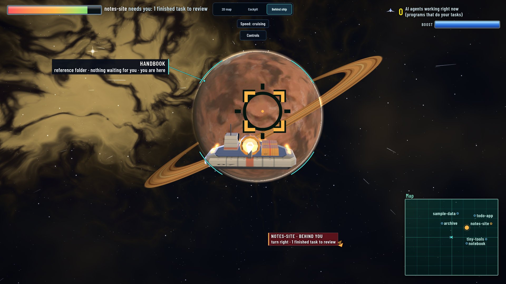
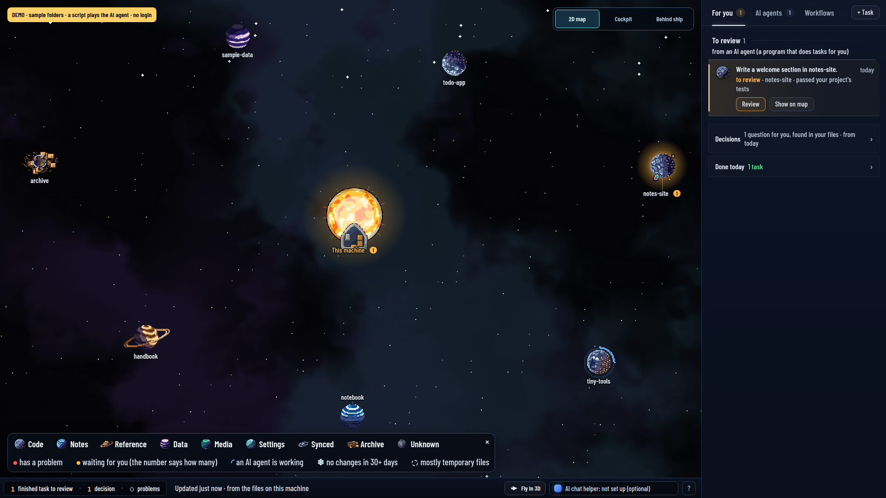

# container-map

**Your folders as a star system, and your coding agents as ships you can watch work.**



container-map turns a folder on your computer into a small star system. Each planet is one of your
folders, the sun is your computer, and every ship is an AI coding agent working on a task you gave
it. Give an agent a job, watch its ship fly to the folder, then look over what it changed and
decide whether to keep it. When you want to, press **I** and fly through it all in 3D.

The map runs on your own computer, needs only Python and git, and sends nothing anywhere; the agents you
choose talk to their own services as they always do. The demo uses a scripted practice agent, so you can
try everything without an AI account.

## See it in one minute

```
python3 cli.py demo
```

That builds a small practice workspace (a few folders, nothing of yours), gives two tasks to a
scripted practice agent (no AI model, no login), and opens the map in your browser. A short guide
walks you through what you see. Press **Ctrl-C** in the terminal to stop.

## Use it on your own work

```
python3 cli.py doctor ~/work      # checks this computer: Python, git, which agents you have
python3 cli.py serve ~/work       # opens your map at http://127.0.0.1:7428/
```

Point it at the folder that holds your projects. To give tasks to a real agent you need one of
these on your PATH: Claude Code (`claude`), Codex (`codex`), Gemini CLI (`gemini`) or aider
(`aider`). The map finds them on its own.

## What you are looking at



| On the map | What it is |
|---|---|
| A planet | One of your folders. Its look tells you what kind (code, notes, data, an archive). |
| The sun | This computer. |
| A ship | An agent working on a task. Its engines burn while it works. |
| A red or yellow mark | Something needs you: a task to review, a check that failed. |
| **For you** (right side) | Everything waiting on you, newest first. |

## Give an agent a task

Press **N** (or **+ Task**), say what you want in plain words, pick the folder and the agent, and
start. For example: *"Add a dark mode toggle to the settings page"*.

- In a git project the agent works on its own copy, so your files are never touched while it works.
- Give the task a **check** if you can: one command that must pass, like `npm test`. If it fails,
  the agent gets the error back and tries again (up to 3 times).
- When it finishes, the task shows up under **For you → Review**. Read what changed, then **Merge**
  to keep it, **Follow up** to ask for more, or **Set aside** to drop it. Nothing is merged without
  you.

## Fly it

Press **I** (or **Fly in 3D**). The ship always flies forward.

| Key | Does |
|---|---|
| **A / D** | Turn (the wings bank into the turn) |
| **W / S** | Nose down / up (it levels itself when you let go; Settings can swap them) |
| **Q / E** | Tilt hard for a tight turn; double-tap for a roll |
| **Shift** | Boost |
| **C** | Brake |
| **V** | Cockpit or behind-the-ship view |
| **L** | Select the planet ahead (**Tab** the next one, **Enter** opens it) |
| **Esc** | Pause; **I** goes back to the map |

The map's view selector also switches between **2D map**, **Cockpit** and **Behind ship**. The in-flight
**Controls** menu lists every key. Near the edge of the map the ship turns back in. On a phone, drag the **Steer** circle
to turn; **Select planet**, **Boost** and **Brake** do the rest.

## Requirements

Linux or macOS with Python 3.10 or newer, git and bash. On Windows, use WSL2 (`wsl --install`) and run it
inside. No packages to install, no account, no network. Optional: tmux (the map shows each tmux window an agent
runs in) and a crontab (the map shows your scheduled jobs).

The page is built from your own computer: your folders, your scheduled jobs and the programs running in your
folders. A command line shows only its plain words, paths and links; anything that could be a password, a
token or a key shows as `[hidden]`. The page file (`game.html`) still names your folders and jobs, so look it
over before you send it to anyone.

Everything below is the full reference: installing it as a service, the headless commands, phone access,
settings, themes and the agent API.

---

# Reference

## Try the loop first

`python3 cli.py demo` needs no agent CLI and no login. It builds a small workspace in a new
folder under `~/.cache/container-map/`: seven folders with code, notes, docs, data and an
archive. Three are git repos. It puts two threads through the real thread engine, using a
scripted agent that calls no model. On `todo-app` the first verify fails, the oracle loop sends
the thread back, the second attempt passes, a check run reviews it (PASS) and it merges. The
thread on `notes-site` stops in review, for you to merge in the page. That takes seconds; then
a third task starts on `tiny-tools`, so you can see an agent working while one task waits
for review and one is merged. The map opens with a short guide; Help replays it.
The map is served on a free port and `Ctrl-C stops the demo` and its running task.

`--no-serve` stops after the threads, `--port N` picks the port, `--root DIR` builds into a new
or empty folder of your own, and `--static` writes the older one-page demo (a generated
six-folder workspace) for `file://`. Every run builds a new folder and leaves it (remove it when
you are done); nothing is written beside the code. Needs Python 3.10+ and git; `--static` needs
neither git nor 3.10 (it renders on any Python from 3.9). Details: [docs/CLI.md](docs/CLI.md).

## Install

Linux or macOS with Python 3.10+, git and bash. Windows is not supported natively (the thread
engine needs `fcntl` file locks and POSIX process groups); on a Windows machine, install WSL2
(`wsl --install`) and follow these steps inside it. Unzip the release (`unzip`, or
`python3 -m zipfile -e` if there is no `unzip`), then from its folder:

```
python3 cli.py --version          # container-map X.Y.Z
python3 cli.py doctor ~/work      # what this machine has: agents on PATH, config, root, port
python3 cli.py init ~/work        # writes ~/work/.container-map/container.json (never overwrites)
python3 cli.py install ~/work     # systemd user unit or launchd agent; try --dry-run first
```

`doctor` exits 1 when something is wrong (a root that does not exist, a `container.json` that does
not parse) and says whose a busy port is. `install` refuses a port that something else holds and
waits up to 15 s for the new bridge, so "installed and started" means it answers; if it does not,
it prints the service's last log lines and exits 1. `python3 cli.py uninstall` stops it and renames
the unit file; nothing is deleted (if stopping fails, the file is kept; `uninstall --force`
retires it anyway). State lives in
`~/work/.container-map/`; inside a git repo, `.container-map/` is added to its `.git/info/exclude`.
Step by step, up to the first thread: [docs/INSTALL.md](docs/INSTALL.md), which also covers pip
(use a venv or pipx: a system Python that the OS manages refuses `pip install --user`).

## Hand it work (N)

Press **N** anywhere (or "+ new task" on Today, or "new task here" on a planet). Say what you
want, pick the folder and the agent, start.

- In a git repo the agent works in **its own worktree**: a separate checkout on branch
  `cm/<task>`, cut from your last commit. Your files are not touched while it works.
- A cargo ship launches from the star and docks at that folder's planet; its engines burn while
  the agent works. The side panel streams what the agent is doing (tool calls, commands, files,
  its words), read from Claude Code's and Codex's JSON output or plain text from anything else.
- When it stops you review: **view changes** shows the diff (everything it committed or left
  uncommitted, against where it started). Then **merge** into the branch it started from (git
  refuses if that would overwrite your uncommitted work; a merge, rebase, cherry-pick, revert or
  am you left unfinished in the repo is never touched, the merge is refused until you finish it,
  and a worktree the agent left on another branch or a detached HEAD is refused, with the command
  that puts it right), **follow up** with another message in
  the same worktree (Claude Code and Codex continue their session), or **set aside**: the work
  is committed onto its branch and the worktree removed. The tool's own commit (what the agent left
  uncommitted) and its merge run with the repository's git hooks off (`core.hooksPath` pointed at
  nothing, `--no-verify`), so a failing pre-commit hook cannot make a thread unmergeable and a hook
  an agent planted in the shared `.git` does not run when you merge; the merge receipt says
  `hooks: off` and the message says no hook was run. `git worktree add`, which makes the thread's folder, keeps the
  repository's own checkout hooks (`post-checkout`, git-lfs) on purpose, so a hook already in the shared `.git` runs then. A worktree whose `.git` file the agent pointed
  somewhere else is not read at all: no git runs in it, a merge is refused and set aside moves it away whole. Build junk the agent left untracked
  (`__pycache__`, `node_modules`, `.DS_Store`, ... : the `merge_skip` list) is not committed, even in a repo
  with no `.gitignore`; the merge receipt and the message name what was left out. Nothing you
  might want is deleted: only the junk the built-in list names (and ignored build folders) goes
  with the worktree; any other file git would delete with it (a `merge_skip` pattern of your own
  names it, say), and a worktree git cannot remove, keep the worktree, which moves to
  `<worktrees folder>/<task>.retired-<stamp>` and the message names what was kept.
- **Where the worktree lives**: `<tasks_dir>-worktrees/<task>` (`worktrees_dir`), beside the
  receipts and never inside them, so an agent's `../task.json` and `../events.jsonl` are not the
  thread's record. Trust model: agents run as your user. This stops accidents and casual forgery,
  not a determined agent that looks the receipts' path up; read the diff and the receipts, not
  the agent's account. **What an agent inherits**: an agent, a check, a verify line and a setup
  line start with your environment minus the map's own variables, by name: `BRIDGE_PORT`,
  `BRIDGE_HOST`, `BRIDGE_LIVE_PATH` (the file that holds the agent token), `BRIDGE_LOG_PATH`,
  `BRIDGE_GAME_PATH`, `BRIDGE_RENDER_PATH`, `BRIDGE_SEATS_PATH`, `BRIDGE_SYNCED_DIR`,
  `CONTAINER_CONFIG`, `CONTAINER_ROOT`, `CONTAINER_OUT`, `CONTAINER_RENDER_SECONDS`,
  `CONTAINER_TMUX_SESSION`, `CONTAINER_WORK_ROOT`, `CONTAINER_AREAS_JSON`, and minus the git
  variables that aim a command at one repository (`GIT_DIR`, `GIT_WORK_TREE`, `GIT_INDEX_FILE`,
  `GIT_OBJECT_DIRECTORY`, `GIT_ALTERNATE_OBJECT_DIRECTORIES`, `GIT_COMMON_DIR`, `GIT_NAMESPACE`,
  `GIT_PREFIX`). Everything else arrives as it is: `PATH`, `HOME`, `LANG`, `TERM`, the agent's own
  login variables, your git identity and config (`GIT_AUTHOR_*`, `GIT_COMMITTER_*`,
  `GIT_CONFIG_*`), `GIT_SSH*`, `GIT_SSL_*`, `GIT_ASKPASS`, and the `env` of the model you picked.
  The wingmate's model command and a board hand-off to a configured runner or to your dispatch
  tool get the same environment.
- Outside a repo the agent works in place; you see which files changed and mark it done.
- **K** lists every task: working, needs you, closed. Every run's exit code is written by a
  small supervisor process next to the agent, so a receipt survives a bridge restart.
- **The oracle loop**: give a thread a **verify** command (one shell line that must exit 0 in
  the thread folder: a test run, a grep, a curl) and up to 3 retries. After each run the command
  runs (unless the thread was stopped or the time cap killed the agent, and even when the agent
  itself exited non-zero) and its receipt is kept; if it fails and retries remain, the agent is
  sent back with the failure as a follow-up until it passes or the retries are spent. A verify or
  setup line that is still running after 600 seconds is ended and recorded as `timed out after
  600 s` (the receipt carries `timed_out` and `limit`, the run log and `thread show` say it, and the
  agent is told the line timed out, not that it exited with -15). The work
  counts as "needs review" only when the command passes. The wingmate adds a VERIFY line to the threads
  it drafts. **Verify passing is not proof of correctness**: it is the thread's own test, and an
  agent can satisfy a test without doing the work (one made an impossible test pass by reading the
  call stack and returning a different number in each test). Every thread shows its `evidence`
  (`none`, `verified`, `checked`, `verified and checked`); get a check by another agent (the
  **Check it** button, `thread check`) before you merge anything that matters, and set
  `"merge_requires_check": true` to make a merge wait for a fresh PASS (`no independent check`).
- **Models**: each agent can offer a list of models (`"models"` in its runner config; Claude Code
  found on PATH offers sonnet / haiku / opus). The composer shows them; the pick is recorded on the
  task and applied as the runner's own args or env.

## Headless

The same threads without a browser, from a shell, a script or another agent. No map needs to be
running; when one is, both work on one task store: `thread` finds the map from the folder it
works on (the nearest folder above the target, or above where you are, with a `.container-map`),
or takes it from `--root DIR` / `--config FILE`.

```
python3 cli.py thread new ~/work/app "add a --version flag" --agent claude \
    --verify "python3 -m pytest -q" --retries 2 --wait     # prints the id, streams the run; 0 = review
python3 cli.py thread show ID                              # summary, verify receipt, the run's log
python3 cli.py thread diff ID                              # the patch, pipeable to git apply
python3 cli.py thread check ID --agent codex --wait        # read-only second opinion; 0 = PASS
python3 cli.py thread merge ID                             # exit 2 while the evidence says no
```

`--wait` runs the oracle loop itself: a failed verify with retries left goes back to the agent
and the wait follows the new run, exiting 0 at review and 1 when the thread ends failed
(a retry that can never go out, because its agent or worktree is gone, ends it as failed and
says why), stopped or lost. The CLI and a running map share the store safely: file locks keep
them from both taking the last free place or changing one repo at once. `merge` lists the blockers (a failed or timed out verify, a verify that never ran, a stopped or
lost last run, a FAIL verdict, work edited after the verify or the check, or evidence that cannot be set against the work) and refuses until `--force`. Also `thread list [--open]`, `reply ID "text" [--wait]`, `stop ID`,
`aside ID` (keep the work on its branch) and `done ID`. Every subcommand takes `--json`: one
object on stdout. Flags, JSON keys and exit codes: [docs/CLI.md](docs/CLI.md).

## Cards and the agent API

Click a planet or folder and a card opens beside the map. **For you**: one sentence of status, the
problems with a "send an agent" button each (it opens a thread aimed there with the problem
written in), three actions, what is inside; the raw facts, cron lines, verbs and the terminal
command sit under "Details". **For agents**: the same card as data, a brief to paste into any
agent, and the calls it can make.

Agents use the bridge with the bearer token in its live file, `ROOT/.container-map/run/bridge-<port>.json` (mode 600, new every boot; `gamectl.py` and the cards find it):

- `GET /agent/map`, `GET /agent/unit?uid=area:notes`, `GET /agent/tasks`, `GET /agent/task?id=…`,
  `GET /file?path=…` (the first 64 KB of a text file under the map's roots, never credentials)
- `POST /agent/task {text, target, runner[, model, isolate]}` (plus `verify`, `retries` and `setup`
  when `agent_verify` is on), `POST /agent/task/followup {id, text}`, `POST /agent/task/check {id, runner}`

Full reference with parameters, examples and errors: [docs/AGENT-API.md](docs/AGENT-API.md).

Merging, setting aside and closing a thread stay with the person: they need the page's UI session,
which the agent token cannot reach and a page from another origin cannot get. That is a fence
against tokens and other websites, not against a process running as you: any local process can
fetch the page and receive the same session cookie your browser gets. A thread's `verify` and
`setup` are shell lines the bridge runs as you, so they are set from the page: an agent's `verify`,
`retries` or `setup` on `POST /agent/task` is refused with a 400 unless `"agent_verify": true` is in
container.json (default `false`). Every agent POST (task, follow-up, check) is audited with `"via": "agent"`; reads are not. Reads use the last world the page built (under 20 s old).

## Who can open your map

The bridge listens on `127.0.0.1` only: nothing outside this computer reaches it. By default, any process on
this computer, run by any user, can open the page with one plain request and get the same session you do. On
your own laptop that is the point (one click, no password). On a computer other people also log in to, it means
another account could open your map and start agent tasks as you.

The lock closes that. Turn it on with `container-map serve ROOT --lock`, `container-map install ROOT --lock`,
or `"ui_lock": true` in `container.json`. A locked map answers a request without a session with a small page
that says it is locked (status 403). It opens only through a private link, `http://127.0.0.1:7428/?k=...`,
printed in the terminal that started it (`install` prints it when it finishes; `container-map link` prints it
again, for the user who started the map). The code in the link is random at every start, is kept only in the
mode-600 file where the agent token already is, and is never written to a log: a service's output is a log, so
`serve` prints the link only to a terminal. Opening the link sets the session cookie and moves you to the plain
address, so the code does not stay in the address bar. `container-map doctor` warns when more than one person
has a login on the computer and the lock is off.

The lock guards the page on this computer. The agent API (its bearer token), MCP and the phone listener are
unchanged: each has its own key. A paired phone never needs the link, and it sees only what "Use it from your
phone" lists: no files, no seats, no agent API. The file preview refuses credential files by name, for the
phone and the desktop alike (private keys, dotenv files, cloud and container logins, Terraform variables and
state, service-account keys, VPN profiles, `.gpg` files and the like).

## Use it from your phone

Off by default. The bridge answers on `127.0.0.1` only, and that does not change. Put a `remote`
block in `container.json` and it opens a second listener, just for paired phones:

```json
"remote": {"listen": "100.101.102.103", "public_origin": "http://100.101.102.103:7429"}
```

- `listen` is one IP address of this machine and `port` (default: the bridge port + 1, so 7429) is
  where the listener sits. `public_origin` is the address the phone types: the page checks every
  request's `Host` and `Origin` against it.
- **Tailscale** (`tailscale ip -4` gives the `100.x` address): the link is WireGuard-encrypted, so
  `http://` is accepted for a `listen` address in `100.64.0.0/10`. **Anywhere else, use https**:
  put a reverse proxy in front (Caddy: `phone.example.com { reverse_proxy 127.0.0.1:7429 }`; nginx:
  `proxy_pass http://127.0.0.1:7429;` with `proxy_set_header Host $host;`), set `listen` to
  `127.0.0.1` and `public_origin` to `https://phone.example.com`. An `http://` origin on any other
  address is refused with the reason, unless `"allow_http": true` says you accept a cookie in clear text.
- A block that is refused is printed, logged and shown in the page; the loopback bridge runs
  either way. A listener that cannot bind (a Tailscale address that does not exist yet when the
  service starts at boot, a port still held) is tried again every 30 seconds until it works, in a
  thread of its own that never holds up the loopback bridge; each kind of failure is printed and
  logged once, and the page and `container-map pair` say it is still trying.

Pair a phone: run `container-map pair` (it asks the running map over loopback and prints the
address and a code), or open the star panel on the desktop and press **Pair a phone**. On the
phone, open the address and type the code: 8 characters, one use, ten minutes (`pair --hours N` for one
that waits up to a week). The phone then
holds its own device cookie (32 random bytes, kept only as a hash in `remote-sessions.json` beside
the tasks folder, mode 600; `HttpOnly`, `SameSite=Lax` (so a link opened from another app keeps the pairing; every change still needs the exact Origin), `Secure` on https, `__Host-` prefixed
on https), good until it has been idle 30 days. Up to 16 devices. `container-map devices` lists
them; `container-map devices --revoke ID` (or **revoke** in the star panel) ends one at once.

Until a device is paired the listener serves nothing but a small pairing page: no map, no
cookie, `GET /` redirects to `/pair`. Pairing codes can only be made from loopback with the page's
session, never by the agent token and never from a phone. Five tries a minute per peer, and 20
wrong codes shut that peer out for 15 minutes. Behind a reverse proxy every phone connects from
the proxy's address, so by default those limits are shared by all of them. Name the proxy in
`remote.trusted_proxy` (a list of IP addresses, default empty: `["127.0.0.1"]` for a proxy on this
machine) and, only for a connection that comes from one of them, the client is the last hop of
`X-Forwarded-For` (the address the proxy itself saw; what a phone puts in front of it is ignored),
so each phone has its own limit and lockout and the audit names the phone. The proxy must send
the header (Caddy does; nginx: `proxy_set_header X-Forwarded-For $proxy_add_x_forwarded_for;`). A
missing or malformed header leaves the proxy's address; a connection from any other address never
has its header believed. The page and `/state`, which a phone polls, are sent gzipped (on both
listeners) to a client that sends `Accept-Encoding: gzip`.

What a phone can do: see the map and the threads, start a thread (words, folder, agent, model;
never with `verify`, `setup` or `retries`, and only on a folder inside a git repo with at least one
commit, where it gets its own worktree: a folder with no repo, or a repo with no commit, is refused
with the reason, because a phone never works in the folder itself, that stays with the desktop
page), read a thread and its diff, reply, stop it, merge or set it aside only when the evidence has
nothing against it (never with force), and ask the wingmate (four questions a minute per device). Every other route is a 404 there:
the agent API, files, seats, doors, verbs, the board, other machines. The page hides those controls
when it knows it is on a phone. Every phone mutation needs the exact `Origin`; a request on the
wrong `Host` is a 421. Refused requests go to `remote-audit.log` next to `remote-sessions.json`
(route, status, reason, peer, and as `tailscale_user_login` the `Tailscale-User-Login` a listed `trusted_proxy`
sent, a record only; never a code or a cookie; it rotates at 256 KB).

## Your wingmate, decay, gravity, battlefields

- **The wingmate** (Scout by default; the skin names it) is the character in the corner. It explains whatever you hover or open, from the page's
  own data, and speaks up when a task needs review or a seat waits on you. Type a question (`/`)
  and the bridge hands the manual plus a snapshot of the map to a model and the wingmate answers; "where
  is X" ends with a jump to it. Only what the page already shows is sent, never file contents.
  With claude on PATH it can answer as Haiku, Sonnet or Opus, and with Codex (OpenAI) or Gemini when
  `codex` or `gemini` is there (either alone is enough);
  or set `"wingmate"` in container.json: `cmd`, `env`, and `models` (`{name, label, family, env?,
  args?, cmd?}`: env merged over the base, args appended, a cmd replacing it) with a `default`.
  The pill in the wingmate's header switches the model (kept in the browser); after an answer, "ask
  <model> too" puts a second model's answer under the first.
- **The meta thread** is the wingmate run over everything at once (the Meta board, key U: the *Triage all* button, or any question
  about the whole map): it reads the map's threads, T3 threads, seats and git worktrees and answers with one
  verdict per item (merge, check, follow-up, set aside, keep, ...). It only recommends; every merge, close,
  rename or removal stays your click. The rules it follows are plain text in `playbooks/meta.md`, which you can edit.
- **Decay**: a code, config or shared planet fades, cracks, gathers haze and drifts outward from
  the ring the longer nothing is written in it. Reference, archive, knowledge and bus planets are
  meant to sit still: they never decay, they only say "quiet · Nd" in grey with the real age.
  Once an hour the renderer appends one line per root to
  `.container-map/history.jsonl` (age, files, stale cron lines, open items, failed tasks); the map
  compares with a week ago and draws a red storm ring on what got worse, a green one on what
  recovered.
- **Planets are yours to choose**: `"planets"` in container.json lists them in order, each
  `{"name", "path", "kind", "desc"}`; a path anywhere (outside the root too). A planet inside another
  planet (notes/areas inside notes) is counted on its own and the parent's walk skips it;
  a seat homes to the deepest planet. With no list, every top-level folder of the root is a
  planet. Today's folder list and the "not on the map" line follow the same list.
- **Gravity**: size on disk is mass. From 100 MB up a folder has a well: rings you see from afar
  and a pull on your ship inside them (Shift breaks free). A purple well is mostly rebuildable
  caches; grey is sheer weight. The star's panel lists planets heaviest first.
- **Battlefields**: a planet's problems (stale cron lines, open board items, failed tasks) circle
  it as red craft; the task ships docked there fire at them while they work. No ships and problems
  = UNDEFENDED. Everything on the map is clickable, labels and the star included.

## The sky: only what needs you

- **Sky mode is on by default.** Everything that waits on a person is one list of contacts (`sky.py`): a seat
  asking for permission or holding your draft, a thread to review or one that failed, a cron line with no fresh
  receipt, an open board item, a blocked task line, an open decision in the ledger, a T3 thread (T3 Code is a desktop app for running coding agents; the map reads its
  threads when `t3_state` names its database) that waits, failed or
  finished unsettled, a night run's result. Each contact is a foe on its planet (around the star when it has none),
  worst first, then oldest, and its craft shows its age: fresh (under a day: small, yellow), aging (up to a week:
  amber), raider (older: big, red). Work that is running is in warp: map threads, T3 threads, background agents and
  tmux seats at work (the carrier too: the map's ship for your main agent session, the *hub*) are counted (`in warp` in the strip is the sky's own count, a small chevron per
  map thread at work beside its planet) and not drawn or picked; a T3 thread you settled or snoozed leaves the sky too (counted as
  settled today or parked). A blocked task line stays a contact however old it gets. With no contact the strip reads EMPTY SKY. Y shows every unit
  again; a world without a sky (or one `sky.py` could not build, said in the top bar) keeps the old map.
- **Keys.** J snaps to the next contact (Shift+J the one before) and says what it is; O opens it: a thread its
  thread, a seat or ship its panel, a T3 thread its T3 link in a new tab, a ledger row Today (read only: a decision
  closes by the owner's dated ruling, never from the map). X turns the sound on and off (the arrival chime too);
  Shift+X has the radio read its calls aloud (off until turned on, and only with a voice that runs on this device). Where the browser offers
  speech recognition on a secure page, holding G listens for a spoken command: next, previous, open, briefing, sky.
  Voice only moves you around; nothing is changed by voice.
- **The strip** reads contacts, in warp, parked and settled today in sky mode, and working, to review, problems
  and crons failing in the full view.
- **The radio** calls in for seats, T3 threads, background agents, the map's own threads and every contact that
  drops into the sky, each with its own line (a pane's last words, a thread's title, a contact's text), four
  queued behind the one on screen; a click or Enter opens what called. A map thread calls the moment the page sees
  it change (the task poll or a world load), once, and a contact whose state changes calls again. When a contact
  leaves and the world shows what resolved it (its T3 thread settled, its thread merged, set aside or marked done, its ledger row
  ruled, its task line done today) the banner says CLEARED with its title, and EMPTY SKY when every contact that left
  was resolved and none is left; a contact that only disappeared (a database that could not be read, a failed thread
  restarted) raises nothing. A skin may carry
  its own words for these in `"radio"` and `"sky"` objects; the neutral ones stand in for anything else.
- **Today** lists the ledger's open decisions row by row in Needs you, oldest first (age, lane, what it blocks,
  id), and a While you slept block: the night run's counts (only the ones its record states) and items from its
  record or its digest line, or a line that says none is on disk.
- **The hangar.** A window that runs only a shell is an empty berth on the dock ring, not a ship. In sky mode a
  seat at rest docks at the star. The comms line counts `BERTHS used/slots · IDLE n` against `hangar_slots`
  (OVER CAP past it), and runners the registry calls dead, down or frozen drift as derelicts on a belt beyond the
  planets. Nothing is ever stopped for it.

## What you see

- **The star** is your root. **Planets** are its subdirectories, in sector wedges by kind
  (code, knowledge, reference, archive, bus, config). Planet type comes from evidence: a gas
  giant is mostly rebuildable dependencies, an ice planet had no writes in 30 days, the archive
  is an asteroid belt, the transient bus is a ring station, the most troubled root is
  Blight-class (the skin picks the word) and pulls its two worst rooms in as satellites.
- **Moons** are the folders inside a planet, sized by files, coloured by file kind, and they
  orbit. Cache folders (node_modules, .venv, build…) are dust clouds, hidden folders (.git,
  .github…) are satellites, small or empty ones are lumpy rocks. Crons are probes and running
  processes drones beside the folder they name.
- **Ships** are your agents: tmux windows, T3 threads, background agents, tasks. A ship working
  inside a folder docks at that planet and burns its engines while it works. Cargo ships are
  traffic that really moved in the last day. Surfaces turn and belts tumble; the motion is
  decoration only and stops under prefers-reduced-motion.
- **Labels** share one layout. Planet tags, ship names, the status badges (NEEDS YOU, YOUR DRAFT,
  LIMITED), thread titles and your own ship's plate are laid out together, after every craft is
  drawn, and printed in one pass on top. Each takes a free place beside what it names: never over
  another plate, a craft or the foes circling a planet, the page's own boxes (comms, the wingmate, the
  HUD, the ticker, the minimap) or past the edge of the view. A plate that finds no free place is
  left out rather than printed over something; pointing at its craft or planet gives it first pick.
  Plates keep the place they had, so they do not jump as you move. More than four plates at one
  planet fold into one ("3 ships · 2 threads · 1 needs you"), which opens while you point at the
  planet, a craft of it or the fold, when you fly up to it or open its card (tap on a phone). The
  hub's carrier name, seat name, state and "hub · you" are one plate. A thread's title shows only
  when you are close, pointing at it or have it open, cut with an ellipsis. In the page's
  console, `__plateAudit()` returns the final rects (screen pixels and world units), the page boxes
  they avoided, the plates left out and the folds.
- **The board (Q)** has two columns. ON YOU: parked decisions, aged by the date on the line
  (DECIDE:, TODO:, FIXME:, QUESTION: in any text file, or markers you configure). AGENT-READY:
  mechanical, reversible items an audit file lists.

## What you can do

| verb | what actually happens |
|---|---|
| new task (N) | an agent runs on your words in that folder (its own git worktree in a repo); you watch, review the diff, merge / follow up / set aside |
| open a door | a tmux window opens **in that directory**, running the worker you assigned to that kind of folder, or a plain shell |
| say | text lands in a seat's composer; **you** press send; the guard refuses if the pane is not provably empty |
| live terminal | a terminal seat's card shows its screen live (colours, scrollback, full-screen programs); click it and type: keys go straight to a configured agent window, a shell window stays view only (desktop only) |
| hand to runner | `runners.<name>.cmd` runs detached in the item's folder with the item text; exit code comes back as the receipt |
| sweep | every agent-ready item to one runner, one at a time, waiting for each receipt; stops on the first failure |
| done / stale | your ruling on a parked decision; the line leaves the board, the file keeps it, reopen puts it back |
| preview / open | read a file in the page (text, capped, never credentials) or open it in your editor |
| cross | jump to another machine's deck: its own render, synced as one JSON file, refused if older than a day |

The bridge listens on loopback only. The page gets a session cookie; agents get a bearer token
for the cards, the control queue that moves the avatar and the thread calls under `/agent/*`
(see "Cards and the agent API"). The shell lines the bridge accepts are a thread's verify and
setup commands (and `worktree_setup` from your config): you type them in the page, and an agent can
set them only when `agent_verify` is on. Every other verb is built into argv by the bridge from
what is on disk.

## Verbs are files

Drop one JSON file in `ROOT/.container-map/verbs/` and every matching planet, room or file
offers it as a button, receipted like any hand-off:

```json
{"name": "git-status", "label": "git status", "applies": ["area", "dir"],
 "cmd": ["git", "-C", "{path}", "status", "--short"], "max_minutes": 2}
{"name": "new-verb", "label": "ask a runner to write a new verb", "applies": ["any"],
 "runner": "*", "text": true, "prompt": "About {path}: {text}. Write one manifest into {verbs_dir}/…"}
```

That second one is the point: a runner can write a verb, the next render offers it, and the map
grows its own tools. Verbs that never get used are flagged after 30 days.

## Themes, skins and texture packs

The map can wear five looks: `classic` (the original, the default), `earthen`, `blueprint`,
`synthwave` and `phosphor`. **V** cycles them (or click one in the legend, L); the pick is kept in
the browser and beats `"theme": "phosphor"` in container.json, which sets the default. (The ids an
earlier version used for the first two still work in a config and in a browser's saved choice.) A theme
is one data file, `themes/<name>.json`: UI colours (the stylesheet runs on CSS
variables, so the whole interface re-skins live, no reload), the space background and scanlines, the
colours of every planet surface, optional 8x8 tiles that wrap the planets, and optional small craft
sprites (freighter, drone, probe, warp gate; a theme that does not redraw them keeps the page's own,
recoloured through its `sprite_palette`). Drop a valid file in `themes/` and it is offered; a broken one
is skipped with a warning when the page is rendered.

A **skin** is separate: it is the craft that play the map's characters (the pilot ship and its boost
variant, the carrier that is the hub's own ship, the raiders that stand for problems), the words written
on the plates (the carrier's label, the banner when a thread merges, the class of the most troubled
planet) and the wingmate's name and portrait. `"skin": "neutral"` in container.json picks it, from
`skins/<name>.json` or from your own folder (`"skins_dir"`); the page does not switch it. The neutral
skin ships: the Kite pilot (a needle nose, ink-violet wings with coral edges), the Hauler carrier with its
ring, a crimson delta raider, a problem drone and a round robot named Scout. Its craft are baked from the 3D
hulls in `skins/neutral-3d.json` (`python3 -I tools/bake_sprites.py`), so the 2D map draws the ship the 3D view
flies. The file shapes are written at the top of `themepacks.py`; `python3 -m unittest test_game`
validates every theme in `themes/` and the shipped skin (a skin of your own is validated when the page
is rendered, and one that fails falls back to `neutral` with the reason). A skin carries its craft, its
words (the banner words at most 16 characters) and a portrait, but not the warp gate (a theme's) and not
the letters `a` and `e` (the page's status colour and engine); the mono palette is fixed, so a skin's own
letters do not show under it. A theme file written for an earlier version that names the planet surface
`blight` by its former name is still read, with a warning.

## Configure (optional)

`ROOT/.container-map/container.json` next to your root, or `--config FILE`:

```json
{
  "version": 1,
  "name": "MY-WORK",
  "extra_areas": {"notes": "~/Documents/notes"},
  "tmux_session": "",
  "decision_words": ["DECIDE:", "TODO:", "FIXME:"],
  "runners": {
    "claude": {"cmd": ["claude", "-p", "--output-format", "stream-json", "--verbose", "--permission-mode", "acceptEdits"],
               "followup_cmd": ["claude", "-p", "--continue", "--output-format", "stream-json", "--verbose", "--permission-mode", "acceptEdits"],
               "max_minutes": 30, "desc": "Claude Code"},
    "aider": {"cmd": ["aider", "--yes-always", "--message", "{text}"], "max_minutes": 20}
  },
  "no_ai_trailers": false
}
```

A runner is an argv: the text goes in as `{text}` or on stdin, and it works in the task's folder.
The same runners take board hand-offs. With no `runners` at all, agent CLIs on your PATH are
offered (`"detect_runners": false` turns that off). Tasks live in `ROOT/.container-map/tasks/`
(`"tasks_dir"` moves them). `"no_ai_trailers": true` tells agents not to sign commits and
refuses to merge a branch whose commits carry `Co-Authored-By`.
`"tick_seconds"` (default 10, `0` = off) is the bridge's own clock for a thread's verify retries,
so they carry on with no page open. `"worktree_setup"` (`{"/path/to/repo": "npm ci", "*": "…"}`) is
one shell line a new worktree thread runs before its agent's first run. `"worktrees_dir"` moves the
worktrees (default `<tasks_dir>-worktrees`), `"merge_skip"` is the list of gitignore-style patterns
a leftover commit leaves out (`[]` = commit everything), and `"merge_requires_check"` makes a merge
wait for a passing check.

`areas.json` beside it names a kind and a worker per folder; `seats.json` names which tmux
windows may be talked to and through which command, and your other machines:

```json
"machines": {
  "pi-4": {"seats": [], "ssh": "pi@192.168.1.40",
           "render_cmd": "cd ~/container-map && python3 cli.py render ~/work"}
}
```

A machine renders itself on request over that ssh route (one constant command, rate-limited,
audited); whatever syncs `~/work/.container-map/` back (Syncthing, rsync, scp) makes it a deck
you can cross to. Nothing runs standing on the other machine. See `container.example.json`
(everyday keys) and `container.sources-example.json` (optional sources, one line each).

Every key is documented in [docs/CONFIG.md](docs/CONFIG.md).

## Gates

```
python3 test_zero.py     # a fresh directory renders in <10 s and leaks nothing from the build machine
python3 -m unittest test_bridge test_tasks test_cli   # the task loop end to end (page, store, CLI) with a fake agent and real git
python3 test_game.py     # includes the label layout in a real headless Chrome when one is on PATH (CHROME_BIN names another)
```

MIT. See [LICENSE](LICENSE) and [NOTICE](NOTICE).
